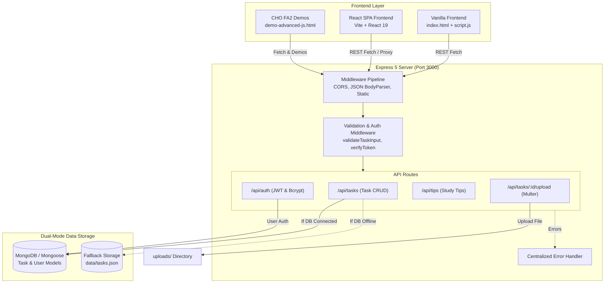
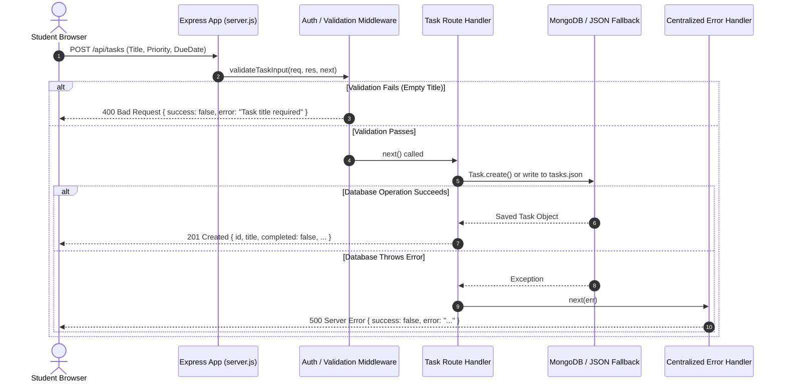
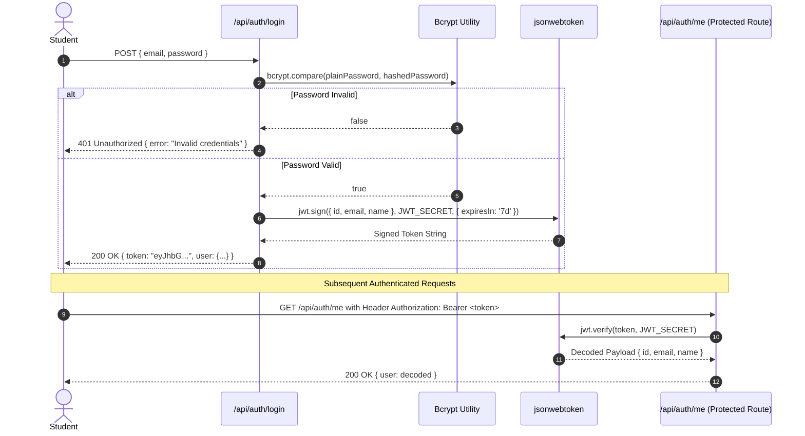

# TaskFlow — System Architecture & Workflow

This document illustrates the complete architectural workflow of **TaskFlow — Student Task Management System**, detailing how client requests travel across the Vanilla UI, React SPA, Express Backend, and Database layers.

---

## 1. High-Level Architecture Diagram

---

## 2. Request-Response Lifecycle Flowchart

---

## 3. JWT Authentication Flow

---

## 4. Dual-Mode Storage Architecture

TaskFlow features a unique **Dual-Mode Persistence Architecture** designed specifically for academic evaluations:

1. **MongoDB Mode (Primary)**:
   - Activates when MongoDB (local or Atlas) is available.
   - Leverages Mongoose Schemas, validation rules, and `populate('user')` relationship queries.
2. **JSON File Fallback Mode (Fail-Safe)**:
   - Activates automatically if MongoDB server is offline or unreachable.
   - Persists all task data into `data/tasks.json`.
   - **Benefit for Viva**: The examiner's laptop might not have MongoDB installed or running; TaskFlow will still run 100% smoothly without crashing!
